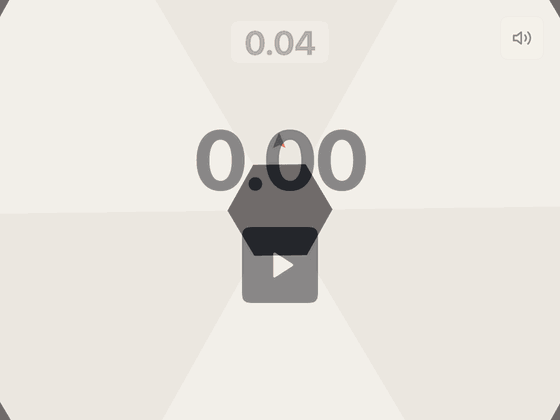

# VÉRTICE

Arcade al estilo Super Hexagon para el navegador: orbita un polígono, cruza los muros que se cierran y encadena rozones. ES Modules nativos y Three.js, banda sonora darksynth procedural, sin build.

<p align="center">
  <a href="https://obeskay.github.io/vertice/"></a>
</p>

<p align="center">
  <a href="https://obeskay.github.io/vertice/"><b>Juega ahora</b></a> · escritorio y táctil · <a href="README.md">English</a>
</p>

---

## Ejecútalo

Sin bundler y sin `npm install`. Sirve la carpeta con cualquier servidor estático:

```bash
git clone https://github.com/obeskay/vertice.git
cd vertice
python3 -m http.server 8089
```

Abre `http://localhost:8089` en Chrome, Safari, Firefox o Edge.

---

## Mecánicas principales

### 1. Doble esquema de control: Arcade 360° y Carriles

- **Arcade 360° (predeterminado)**: navegación orbital suave alrededor del perímetro del polígono, con inclinación física de la nave (banking) y estelas de propulsión.
- **Carriles discretos**: salta al instante entre los lados del polígono, para quien prefiere un movimiento tipo puzzle geométrico.
- **Mouse / puntero**: seguimiento angular 1:1 del cursor, sin retraso de entrada.
- **Táctil (móvil)**: zonas de toque izquierda/derecha en pantalla dividida; toca con dos dedos para activar el Turbo.

### 2. Audio darksynth procedural con sidechain ducking

- **Sintetizador propio en Web Audio**: genera arpegios dinámicos, sub-bajo pulsante y bombos 808 contundentes directamente en código, sin archivos de audio externos.
- **Sidechain ducking**: cada golpe de bombo atenúa los canales de bajo y acordes para lograr una compresión electrónica con punch.
- **Filtro pasa-bajos dinámico**: barre automáticamente la frecuencia de corte durante los power-ups de cámara lenta y en el Game Over.
- **BPM en aceleración**: el tempo sube conforme avanza tu partida, desde el tempo base de cada modo (120–176 BPM) hasta un tope de 240 BPM.

### 3. Locutor de voz robótica

Un comentarista arcade integrado anuncia los momentos clave en tiempo real con la Web Speech API, sobre un chime de vocoder sintetizado:
`"VÉRTICE... START!"`, nombres de rango (`"TRIÁNGULO"`, `"CUADRADO"`, `"HEXÁGONO"`, `"VÉRTICE"`…), `"ESCUDO"`, `"CALMA"`, `"FLOW COMBO!"`, `"HYPERDRIVE!"`, `"GAME OVER"`, `"NEW RECORD!"`.

### 4. SYNC ♪ (modo osu! reactivo al audio)

Haz clic en `SYNC ♪` en el menú principal para capturar el audio de una pestaña de YouTube, Spotify Web o SoundCloud con la API MediaStream del navegador. El motor rastrea en vivo los picos de frecuencia y sincroniza la aparición de muros, los pulsos del fondo y la velocidad de los muros con el BPM de la música.

---

## Modos de juego

| Modo | Rampa de velocidad | Características |
|---|---|---|
| **NORMAL** | 4.3 → 9.8 | Progresión geométrica clásica de Punto a Vértice. Curva de velocidad equilibrada. |
| **HIPER** | 6.5 → 11.6 | Prueba de reflejos a alta velocidad para pilotos experimentados. Ventanas de reacción más cortas. |
| **EXTREMO** | 8.8 → 13.5 | Velocidad implacable con inversiones de rotación repentinas e impredecibles. |
| **ZEN** | 3.9 → 5.0 | Flujo infinito sin muerte. Ideal para calentar el ritmo. |

---

## Controles

| Tecla / entrada | Acción | Comportamiento |
|---|---|---|
| `←` / `→` o `A` / `D` | Girar | Contraviraje instantáneo, cero sensación resbalosa |
| `ESPACIO` / `S` / `↓` / clic derecho | **Phase Dash** | Salto orbital cuántico con 220 ms de invulnerabilidad (se recarga con rozes) |
| `SHIFT` / `W` / `↑` | Turbo | Aumenta la velocidad orbital (×1.6) con líneas de velocidad |
| **Cursor del mouse** | Seguimiento directo | La nave apunta al ángulo del cursor (clic derecho para Dash) |
| **Controles táctiles** | Girar y Dash | Zonas de toque izquierda/derecha; botón central `DASH` |
| `ENTER` / `R` | Empezar / reiniciar | Reinicio instantáneo, sin espera |
| `ESC` / `P` | Pausa | Abre el menú de pausa |

---

## Power-ups y mecánicas clave

- **PHASE DASH** (`ESPACIO` / `S` / `↓` / clic derecho): ráfaga cuántica instantánea con 220 ms de invulnerabilidad. Atraviesa los muros que se cierran. Cooldown base de 2.8 s, que se reduce **1.0 s con cada roze (near-miss)**.
- **COMBO HYPERDRIVE**: encadena rozes consecutivos (`x1 → x2 → x3 → x4 → x5`). Cada roze suena con una nota pentatónica ascendente (C5 → E6) y sube el multiplicador de combo (hasta ×8). Al llegar a 5 rozes se activa **HYPERDRIVE**: 2.0 s de fase fantasma, sacudida de pantalla y overdrive armónico del sintetizador.
- **NAVE FANTASMA**: graba automáticamente a 20 Hz la trayectoria de tu mejor partida y proyecta en tiempo real una nave-sombra holográfica translúcida.
- **ESCUDO** (cuadrado blanco): te salva de un choque. Absorbe el impacto y aplasta los muros cercanos.
- **CALMA** (triángulo verde): activa 3.2 segundos de vuelo en cámara lenta, con un filtro pasa-bajos que hace sonar el audio sumergido y latidos rítmicos.
- **PATRONES DINÁMICOS**: anillos giratorios **Twister**, compuertas pulsantes **Pulsar** y patrones **Double Reflex** y **Corridor**, además de 16 patrones clásicos.

---

## Arquitectura y estructura del código

El motor usa un **loop de simulación de paso fijo a 240 Hz** (`SIM_DT = 1/240`) con render WebGL interpolado a nivel subpíxel vía Three.js, para que la detección de colisiones siga siendo determinista incluso a velocidades de rotación extremas.

```
vertice/
├── index.html               Dock del HUD neobrutalista, overlays e import map
├── style.css                Tipografía Space Grotesk y estilos de UI de alto contraste
├── assets/
│   └── cover.png            Arte de portada
├── vendor/
│   └── three.module.js      Three.js autocontenido (funciona sin conexión)
└── src/
    ├── main.js              Game loop a 240 Hz, ruteo de entradas y máquina de estados
    ├── engine/
    │   ├── Renderer.js      Escena Three.js, roll/shake de cámara y gajos de fondo
    │   ├── ShaderPass.js    Post-procesado (aberración cromática, speed lines, grano de película)
    │   ├── AudioEngine.js   Sintetizador darksynth con sidechain ducking y filtros biquad
    │   ├── VoiceEngine.js   Síntesis de voz robótica arcade
    │   ├── PaletteManager.js Deriva continua de hue HSL y roles de color de alto contraste
    │   ├── MusicSync.js     Detector de beats de audio externo para el modo SYNC (osu!)
    │   └── ParticleSystem.js Estelas de propulsión, ondas expansivas y fragmentos de explosión
    ├── game/
    │   ├── Player.js        Física de movimiento dual 360°/carriles e inclinación (banking)
    │   ├── WallManager.js   20 patrones rítmicos de obstáculos y colisión por barrido
    │   ├── PowerUpManager.js Lógica de aparición de escudos y fichas de cámara lenta
    │   ├── LevelSystem.js   Escalado de rangos, etapas poligonales y rotaciones orgánicas
    │   └── ScoreSystem.js   Récords por modo, calificaciones (S+ a D) y puntajes locales
    └── ui/
        └── HUDManager.js    Overlays del DOM, toggles de ajustes y tablas de récords
```

---

## Verificación estática

Para verificar que todos los assets, imports y scripts locales estén completos:

```bash
# Revisa la integridad de los assets estáticos locales
python3 -c "
import os
files = ['index.html', 'style.css', 'vendor/three.module.js', 'src/main.js', 'assets/cover.png']
for f in files:
    assert os.path.exists(f), f'Missing: {f}'
print('All static assets verified successfully.')
"
```

---

## Licencia

MIT. Juégalo, haz tu fork, compártelo.
