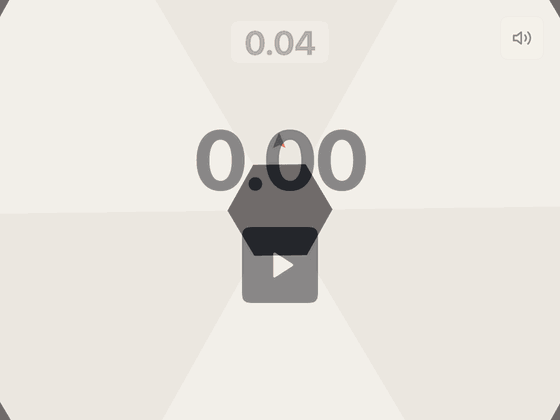

# VÉRTICE

A Super Hexagon-style arcade for the browser, one-button simple. Walls close in on the center; steer your ship through the gaps for as long as you can. One mode, no menus, and the difficulty climbs slowly the longer you last.

<p align="center">
  <a href="https://obeskay.github.io/vertice/"></a>
</p>

<p align="center">
  <a href="https://obeskay.github.io/vertice/"><b>Play it now</b></a> · desktop and touch · <a href="README.es.md">Español</a>
</p>

## Run it

No build step and no `npm install`: vanilla ES modules plus a vendored Three.js.

```bash
git clone https://github.com/obeskay/vertice.git
cd vertice
python3 -m http.server 8089
```

Open `http://localhost:8089`. GitHub Pages serves `main` as is.

## How it plays

- Tap the play button (or press any steer key, `Space` or `Enter`) and survive. Your time is your score; your best is kept in the browser.
- Every 15 to 30 seconds the run steps up: walls get faster, the spin gets stronger, and the shape gains sides (6 → 7 → 8 → 10 → 12). After about 105 s it keeps creeping up on its own.
- Pass a hair from a wall edge and it chimes; chain those near misses and the note climbs the scale.
- The wall that kills you turns orange. Any steer key or a tap starts again a moment later; holding a key through the crash never restarts by accident.
- The music is a soft A-minor arpeggio that speeds up with the run. Every sound, from the grazes to the crash, uses the same voice and key. The speaker button mutes it and remembers your choice.

## Controls

| Input | Action |
|---|---|
| `←` / `→` or `A` / `D` | Steer |
| Left / right half of the screen | Steer (touch or mouse) |
| `Space` / `Enter` / `R` | Play / play again |
| `Esc` / `P` | Pause |

## Code

```
index.html, style.css     One overlay (menu, pause, result), the timer and two buttons
src/main.js               240 Hz fixed-step loop, input, state machine (menu, playing, dying, paused, over)
src/palette.js            The three colors: paper, ink, accent
src/engine/Renderer.js    Orthographic Three.js scene: background wedges and the center polygon
src/engine/AudioEngine.js WebAudio music and sound effects, all one mallet voice
src/engine/ParticleSystem.js Graze ripple and crash burst
src/game/Player.js        Orbiting ship with counter-steer
src/game/WallManager.js   Ring patterns, fair spacing and swept collision
src/game/LevelSystem.js   The difficulty ramp and the rotation flips
src/game/ScoreSystem.js   Run time and best time
src/ui/HUDManager.js      DOM state for the overlay, timer and sound button
```

`docs/prompts/` and `docs/aprendizaje.md` describe earlier versions (modes, power-ups, voice, music sync) and are kept as history.

## Verify

```bash
node scripts/check-walls.mjs
```

Checks grazes, the fair first ring, ring spacing at low and high speed, seeded patterns, rotation flips and that the difficulty ramp never goes down.

## License

MIT. Play it, fork it, share it.
