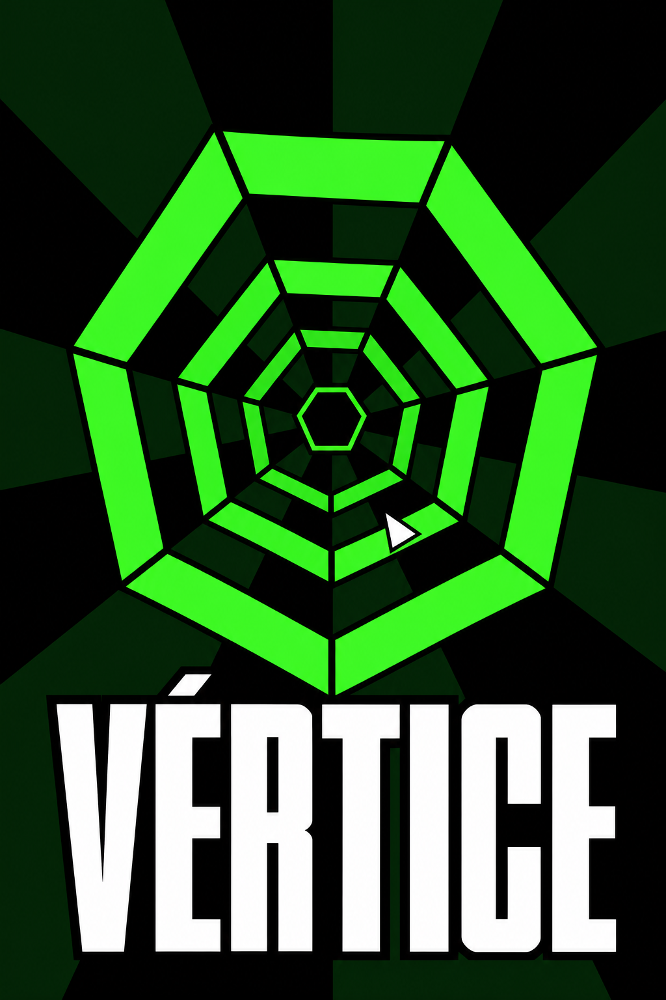

# VÉRTICE



Arcade de precisión hipnótico para el browser. Neobrutalista, minimalista,
adictivo. Inspirado por Super Hexagon, con identidad propia: **el número de
lados del nivel es tu número de posiciones de movimiento**.

**Jugar local:**
```bash
python3 -m http.server 8088
# abre http://localhost:8088
```

## La mecánica identidad: CARRILES

Cada tap mueve UN carril con deslizamiento ease-out (~80ms). El mouse apunta al
carril más cercano al cursor, fijado en coordenadas de mundo (el mundo gira, tu
objetivo no se arrastra).

| Rank | Lados = Carriles |
|---|---|
| PUNTO / LÍNEA | 2 |
| TRIÁNGULO | 3 |
| CUADRADO | 4 |
| PENTÁGONO | 5 |
| HEXÁGONO | 6 |
| VÉRTICE | 8 |

El fondo se divide en **gajos** (cuñas A/B del mismo hue) que contra-rotan con
parallax contra los muros. El centro adopta la forma del nivel. La dificultad
es la geometría misma.

## Controles

- `←` / `→` o `A` / `D`: saltar de carril (hold = auto-repeat)
- **Mouse**: apunta al carril (precisión quirúrgica)
- `SHIFT` / `W` / `↑`: **TURBO** (transiciones ×1.7)
- Móvil: toca izquierda/derecha, dos dedos = turbo
- `ESPACIO`: empezar/reiniciar · `ESC`: pausa

## Power-ups y combos

- **ESCUDO** (cuadrado): una muerte gratis, aplasta los muros cercanos
- **CALMA** (triángulo): cámara lenta 3s para respirar
- **FLOW**: encadena 3 rozes (near-miss) y gana 1.5s de invulnerabilidad

Los orbes viajan en los huecos de los anillos: agarrarlos exige atravesar el
gap con precisión. Riesgo/premio puro.

## SYNC ♪ (modo osu!)

Pulsa `SYNC ♪`, elige la pestaña donde suena tu música (YouTube, Spotify web)
marcando "Compartir audio de la pestaña", y el juego detecta los beats en vivo:
los muros spawnean cuantizados al beat, la velocidad se adapta al BPM estimado
y los pulsos visuales siguen tu canción. La música sintética se silencia
mientras dura. (Detecta beats y BPM; no el nombre de la canción.)

## Por qué se siente bien (técnicas)

- **Fixed timestep 240Hz + interpolación de render**: física idéntica en 60Hz y 240Hz
- **Swept collision**: la banda radial del jugador se barre entre frames; el tunelaje es imposible
- **Hitbox más chica que el sprite**: "rozé y no morí" se siente justo
- **Hitstop + slow-mo** al morir, **near-miss** con shockwave hexagonal
- **Geometrías cacheadas** por número de lados, cero reconstrucción por frame
- **Audio 100% sintético** (Web Audio): kick, hats, bajo con sidechain, BPM que acelera
- **Beat tracking externo**: energía de bombo 40-190Hz con umbral adaptativo + mediana de intervalos
- **Anti-epilepsia**: hue shift 6°/s, flash 0.02, respeta `prefers-reduced-motion`
- 14 draw calls en juego típico. Three.js vendored, sin build, sin dependencias

## Estructura

```
src/
  main.js                orquestador: game loop, input, estados
  engine/
    Renderer.js          cámara, gajos (parallax), centro poligonal, shake/FOV
    PaletteManager.js    hue drift, pares de color por rol
    AudioEngine.js       música sintética + SFX (Web Audio)
    MusicSync.js         captura de pestaña + beat tracking (modo osu!)
    ParticleSystem.js    trail, shockwaves, polvo
  game/
    Player.js            carriles, easing, hitbox
    WallManager.js       patrones, swept collision, near-miss
    PowerUpManager.js    orbes en los gaps
    LevelSystem.js       ranks = lados, velocidad con onda, reversas telegrafiadas
    ScoreSystem.js       tiempo, récord, rozes
  ui/
    HUDManager.js        HUD mínimo, overlays, toasts
```

## Hecho con IAs (y un humano con criterio)

Construido en una sesión con agentes de IA coordinados por markdown (el log real
está en `docs/prompts/`). El artículo de aprendizajes:
**[docs/aprendizaje.md](docs/aprendizaje.md)** — cómo modelos como Kimi K3
hacen posible el desarrollo de videojuegos.

## Licencia

MIT. Juégalo, rómpelo, haz fork.
